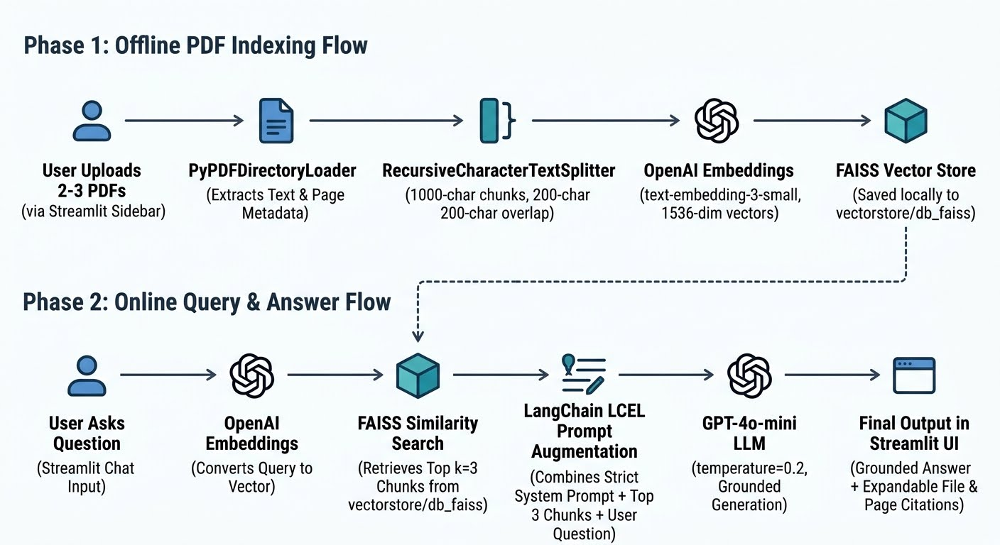

# Local PDF Retrieval-Augmented Generation (RAG) Pipeline

A lightweight Python 3.12 and Streamlit RAG web application that extracts text from local PDF documents, generates semantic vector embeddings using OpenAI, indexes them locally via FAISS, and answers natural-language queries with source citations.

---

## 1. Architecture Workflow



### Phase 1: Offline Indexing (Preparation)
* **Load:** `PyPDFDirectoryLoader` reads uploaded PDFs page by page and attaches filename and page metadata.
* **Chunk:** `RecursiveCharacterTextSplitter` breaks text into 1,000-character segments with a 200-character overlap to preserve context across boundaries.
* **Embed:** `OpenAIEmbeddings` (`text-embedding-3-small`) converts each text chunk into a dense numerical vector.
* **Store:** `FAISS` indexes the vectors and saves them locally to `vectorstore/db_faiss` so documents do not need to be re-embedded on every query.

### Phase 2: Online Querying (Retrieval & Generation)
* **Embed Query:** Your chat question is converted into a vector using the same OpenAI embedding model.
* **Retrieve:** FAISS performs similarity search against the stored vectors and pulls the **top 3 (`k=3`)** closest chunks.
* **Augment:** LangChain Expression Language (LCEL) injects the retrieved chunks into a strict system prompt alongside your question.
* **Generate:** `gpt-4o-mini` synthesizes a grounded answer using only the retrieved context and lists exact file and page citations.

---

## 2. Components Used

| Component | Tool / Library / Model | Role in the RAG Pipeline |
| :--- | :--- | :--- |
| **User Interface** | `Streamlit` | Provides the browser-based sidebar for API key entry, multi-PDF upload, indexing controls, and interactive chat. |
| **Orchestration** | `LangChain` (`langchain-core`, `langchain-community`) | Connects document loading, splitting, vector retrieval, and prompt chaining via LangChain Expression Language (LCEL). |
| **Document Loader** | `PyPDF` (`PyPDFDirectoryLoader`) | Extracts raw text and source metadata (file name and page number) from uploaded PDF files. |
| **Text Splitter** | `RecursiveCharacterTextSplitter` | Splits extracted pages into 1,000-character chunks with a 200-character overlap to preserve sentence boundaries. |
| **Embedding Model** | OpenAI `text-embedding-3-small` (`langchain-openai`) | Converts document chunks and user questions into 1,536-dimensional dense vectors for semantic comparison. |
| **Vector Store** | `FAISS` (`faiss-cpu`) | Indexes dense vectors locally on disk (`vectorstore/db_faiss`) and executes fast top-`k` (`k=3`) similarity searches. |
| **Language Model (LLM)** | OpenAI `gpt-4o-mini` (`ChatOpenAI`) | Synthesizes grounded answers strictly from retrieved chunks (`temperature=0.2`) to prevent hallucinations. |
| **Tokenizer** | `Tiktoken` | Handles token counting and text encoding compatibility for OpenAI models. |
| **Testing Framework** | `Pytest` & `FakeEmbeddings` | Runs offline unit tests to validate chunk sizes, metadata retention, and FAISS persistence without API calls. |
| **Runtime & IDE** | Python 3.12 & Visual Studio Code | Isolated virtual environment (`venv`) and development workspace. |

---

## 3. Project Directory Structure

Create a project folder (e.g., `my-rag-project/`) with the following files:

```text
my-rag-project/
├── data/                        # Uploaded PDFs stored during indexing (auto-created)
├── vectorstore/                 # Auto-generated local FAISS index (auto-created)
├── app.py                       # Main Streamlit RAG web application
├── test_rag.py                  # Automated offline pytest suite
├── requirements.txt             # Python 3.12 dependency manifest
├── architecture_workflow.png    # RAG pipeline architecture diagram
└── README.md                    # Project documentation
```

---

## 4. Setup & Installation Instructions

### Step 1: Prerequisites
* **Python 3.12** installed on your system.
* **Visual Studio Code** with the official **Python** extension installed.
* An active **OpenAI API Key** (`sk-...`).

### Step 2: Create `requirements.txt`
Ensure your `requirements.txt` file in the root folder contains:
```text
langchain>=1.0.0
langchain-openai>=0.3.0
langchain-community>=0.3.14
langchain-text-splitters>=0.3.5
faiss-cpu>=1.9.0.post1
pypdf>=5.1.0
tiktoken>=0.8.0
streamlit>=1.40.0
pytest>=8.0.0
```

### Step 3: Set Up a Python 3.12 Virtual Environment
Open the integrated terminal in VS Code (`Ctrl + `` ` `` on Windows/Linux, `Cmd + `` ` `` on macOS) and run the commands for your OS. Using a virtual environment prevents **PEP 668 (`externally-managed-environment`)** errors.

#### **Windows (PowerShell)**
```powershell
# 1. Verify Python 3.12 is available
py -3.12 --version

# 2. Create and activate the virtual environment
py -3.12 -m venv venv
.\venv\Scripts\Activate.ps1

# 3. Upgrade pip and install all packages
python -m pip install --upgrade pip
python -m pip install -r requirements.txt
```
*(Note: If PowerShell blocks script execution, run `Set-ExecutionPolicy -ExecutionPolicy RemoteSigned -Scope CurrentUser` first.)*

#### **macOS / Linux**
```bash
# 1. Verify Python 3.12 is available
python3.12 --version

# 2. Create and activate the virtual environment
python3.12 -m venv venv
source venv/bin/activate

# 3. Upgrade pip and install all packages
python -m pip install --upgrade pip
python -m pip install -r requirements.txt
```

### Step 4: Select the Interpreter in VS Code
1. Press `Ctrl + Shift + P` (Windows/Linux) or `Cmd + Shift + P` (macOS).
2. Type and select **Python: Select Interpreter**.
3. Choose the interpreter pointing to **`./venv` (Python 3.12.x)**.

### Step 5: Configure Your OpenAI API Key (Optional Pre-fill)
You can paste your API key directly into the Streamlit sidebar when running the app, or set it in your terminal session beforehand:

* **Windows (PowerShell):**
  ```powershell
  $env:OPENAI_API_KEY="sk-your-actual-api-key-here"
  ```
* **macOS / Linux:**
  ```bash
  export OPENAI_API_KEY="sk-your-actual-api-key-here"
  ```

---

## 5. Running the Application

With `(venv)` visible in your terminal prompt, start the Streamlit server:

```bash
python -m streamlit run app.py
```

1. Open **`http://localhost:8501`** in your browser if it does not open automatically.
2. Enter your **OpenAI API Key** in the left sidebar (if not already set via environment variable).
3. Upload **2–3 PDF documents** and click **Process & Index PDFs**.
4. Type questions into the chat bar at the bottom and expand **Sources Consulted** under each reply to inspect the source files and page numbers.

---

## 6. Verification & Testing

### Automated Unit Tests (Offline)
Verify document chunking, context formatting, and local FAISS indexing offline without spending OpenAI API tokens:

```bash
python -m pytest -v
```

### Hallucination & Guardrail Verification
Because the system prompt restricts `gpt-4o-mini` (`temperature=0.2`) to answering strictly from the retrieved context chunks, verify your guardrails using out-of-scope prompts once your PDFs are indexed:

* **Test Prompt 1 (Unrelated Technical Concept):** *"What do these documents say about calibrating a quantum flux capacitor?"*
* **Test Prompt 2 (External World Fact):** *"According to the uploaded PDFs, what is the current population of Tokyo?"*
* **Test Prompt 3 (Fabricated Policy/Metric):** *"What is the exact 2029 refund penalty rate listed in Appendix Z?"*

**Expected Guardrail Behavior:**
* The assistant must explicitly state that it **cannot find the answer in the provided documents**.
* It must **not** rely on general pre-trained knowledge or invent plausible-sounding details.
* Check the **Sources Consulted** expander to confirm the retriever returned the top 3 nearest chunks even when similarity was low, proving the LLM's system prompt blocked the hallucination.

---

## 7. Troubleshooting

* **PEP 668 `externally-managed-environment` Error:** Ensure `(venv)` is active in your terminal prompt before running `python -m pip install`.
* **ModuleNotFoundError:** Always invoke Streamlit and Pytest via `python -m streamlit run app.py` and `python -m pytest` so they use your active virtual environment.
* **Empty Text Extraction:** Ensure your PDFs contain selectable text rather than scanned images.
* **Resetting Your Documents:** Click **Clear Index & Chat History** in the Streamlit sidebar before uploading a new batch of PDFs.
